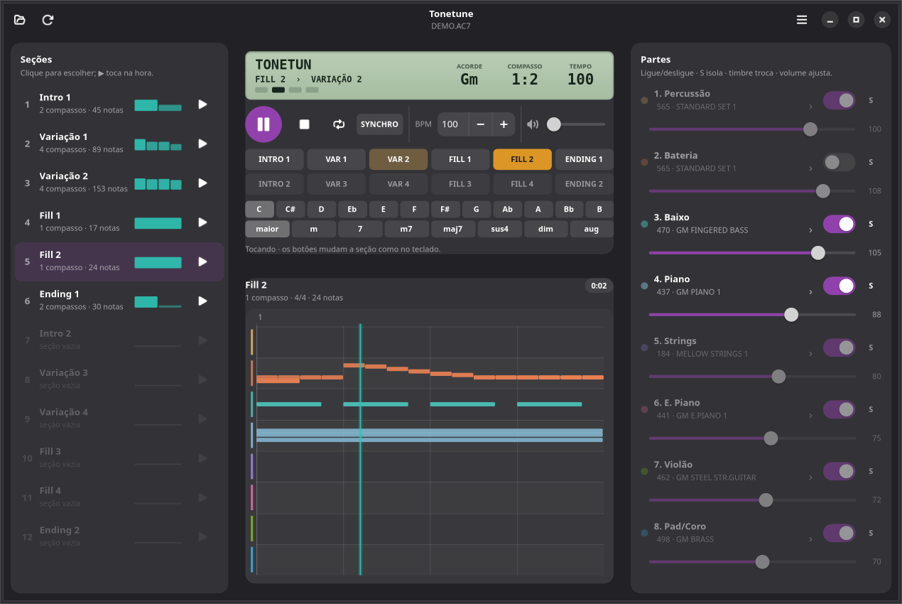
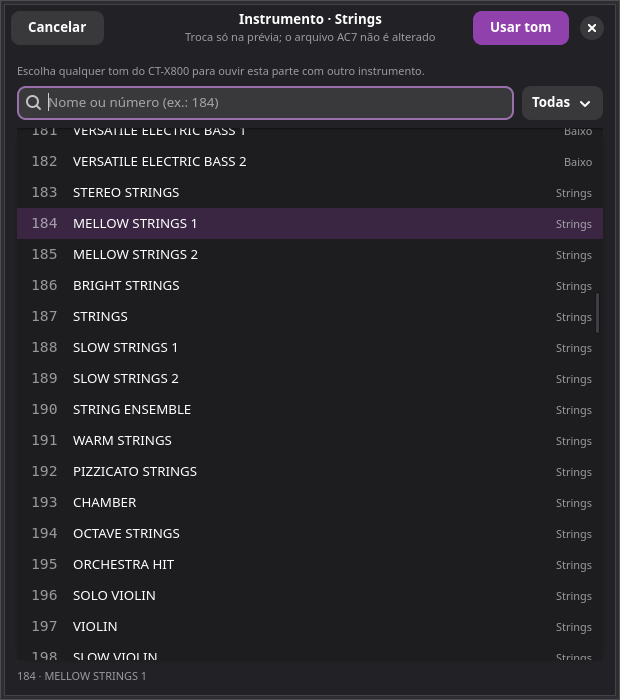

# Tonetune

<p align="center">
  
</p>

<p align="center">
  <b>Reprodutor de ritmos AC7 do Casio CT-X800</b><br>
  Ouça e teste seus ritmos no PC sem precisar ir ao teclado.
</p>

<p align="center">
  
</p>

## O que é

O **Tonetune** é um reprodutor leve para arquivos `.AC7` do Casio CT-X800
(e da família CT-X). Ele abre o ritmo, mostra as seções e as oito partes e
toca o ritmo como no teclado: painel de seções, virada, final, acorde e
transições sem emenda, usando um SoundFont GM.

Ele foi criado a partir do
[ctx800-editor](https://github.com/Denilsonnofficial/ctx800-editor), mas é uma
ferramenta separada e **somente de reprodução**: não edita, não salva e não
exporta AC7. O fluxo é:

1. editar o ritmo no editor (ou por script);
2. abrir o `.AC7` resultante no Tonetune;
3. escolher a seção e ouvir;
4. quando o arquivo for regravado, o Tonetune **recarrega sozinho**.

Assim dá para testar uma alteração de bateria, baixo, strings ou volume sem
levar o pendrive ao teclado a cada tentativa.

## Recursos

- Abre arquivos `.AC7` com 6 ou 12 elementos.
- Lista **Intro 1/2, Variações 1–4, Fills 1–4 e Endings 1/2**, mostrando
  compassos, notas e uma miniatura de atividade por compasso.
- **Oito partes** com interruptor liga/desliga, solo (**S**), volume ajustável
  e troca de instrumento.
- **600 tons do CT-X800** (e os 36 kits de bateria) no seletor de instrumento,
  com busca por nome/número e filtro por categoria.
- **Painel como o do teclado**: visor com compasso, tempo e acorde, luzes de
  tempo e botões INTRO, VAR, FILL, ENDING e SYNCHRO.
- **Motor ao vivo** com libfluidsynth e GStreamer: andamento, acorde, mixagem e
  timbres mudam na hora, sem preparar áudio e sem emenda no loop.
- **Seletor de acorde** com os 12 acordes maiores e os menores das notas
  naturais (Cm, Dm, Em, Fm, Gm, Am, Bm).
- Controle de **andamento** para testar o ritmo mais devagar ou mais rápido
  (não altera o arquivo).
- Volume geral independente do volume gravado no ritmo.
- As trocas de instrumento e volume são **só da prévia**: o `.AC7` não é
  modificado. O menu **Restaurar mixagem do AC7** desfaz tudo.
- Linha do tempo colorida com as notas de todas as partes e playhead.
- **Recarregamento automático** quando o arquivo é salvo por outro programa.
- Abrir por botão, arrastar e soltar, arquivos recentes ou linha de comando:
  `tonetune MEU_RITMO.AC7`.
- Atalhos de teclado para trocar de seção e tocar sem parar.
- Ícone SVG próprio, integrado ao menu de aplicativos do Lig OS/GNOME.
- Tema claro e escuro do sistema.

## Requisitos

Testado no Debian 13 (Lig OS), com GTK 4, Libadwaita, GStreamer, FluidSynth e
Python 3.

```bash
sudo apt install python3-gi gir1.2-gtk-4.0 gir1.2-adw-1 \
    gir1.2-gstreamer-1.0 gir1.2-gst-plugins-base-1.0 \
    gstreamer1.0-plugins-base gstreamer1.0-pulseaudio \
    fluidsynth fluid-soundfont-gm
```

## Instalar

```bash
git clone https://github.com/Denilsonnofficial/tonetune.git
cd tonetune
./install.sh
```

O `install.sh` cria o atalho `tonetune` em `~/.local/bin`, registra o aplicativo
no menu, instala o ícone SVG e associa arquivos `.AC7` ao Tonetune.

> O instalador também remove o atalho antigo do **Editor de Ritmos CT-X800**,
> se ele existir. O código-fonte em `~/ctx800` e o repositório do GitHub não
> são alterados.

Depois é só procurar por **Tonetune** no menu ou rodar:

```bash
tonetune
tonetune /caminho/DO_RITMO.AC7
```

Para rodar sem instalar:

```bash
./run.sh
# ou
python3 main.py
```

## Como usar

1. Abra um `.AC7` pelo botão **Abrir ritmo**, pelo menu ou arrastando o arquivo
   para a janela.
2. A **Variação 1** é selecionada automaticamente quando existe.
3. Aperte **Espaço** ou o botão de play para começar.
4. Use os botões do painel, a lista de seções ou as teclas **1–9** para mudar
   a seção durante o ritmo (veja [Como o ritmo se comporta](#como-o-ritmo-se-comporta)).
5. Ligue/desligue uma parte no **interruptor** e use **S** para isolar.
6. Arraste o **volume** da parte para ouvir uma faixa mais forte ou mais fraca.
7. Clique no **nome do timbre** para abrir o seletor e escolher outro
   instrumento. **Usar tom** aplica; **Restaurar do AC7** volta ao original.
8. Ajuste o **BPM** ou o volume geral se quiser testar em outra condição.
9. Salve o ritmo de novo no editor: o Tonetune recarrega e reinicia a seção
   automaticamente se estiver tocando.

### Como o ritmo se comporta

| Botão | Parado | Tocando |
|---|---|---|
| INTRO | toca a intro e segue para a variação | entra no próximo compasso |
| VAR | começa nela | outra variação entra no próximo compasso; a mesma toca a virada dela e volta |
| VAR durante intro ou virada | — | fica na fila e entra quando a seção acabar |
| FILL | toca a virada e segue para a variação | entra no próximo tempo, na posição do compasso |
| ENDING | toca o final e para | entra no próximo compasso e para sozinho |
| SYNCHRO | o ritmo espera e começa ao escolher um acorde | — |

A seção que está na fila pisca no painel e aparece no visor. O botão de
repetição serve para conferir uma seção isolada: ela fica em loop e a troca é
imediata.

### Trocar instrumento e volume

Clique no nome do timbre de qualquer parte para abrir a lista dos 600 tons (ou
dos kits de bateria, nas partes 1 e 2). A busca aceita nome ou número, e o
filtro separa por categoria. O tom escolhido e o volume do slider valem só para
a prévia; o AC7 continua igual. Para voltar tudo ao original, use
**Restaurar mixagem do AC7** no menu.



### Atalhos

| Ação | Atalho |
|---|---|
| Tocar / pausar | Espaço |
| Parar | Esc |
| Repetir só a seção atual | L |
| Apertar o botão da seção 1–9 (e 0 para a 10) | 1–9, 0 |
| Recarregar arquivo | F5 |
| Abrir outro ritmo | Ctrl+O |
| Isolar uma parte | botão S |
| Ligar/desligar, trocar timbre e volume | controles de cada parte |

## O que é fiel e o que é aproximado

Por padrão, o Tonetune usa os patches, volumes, pans, reverbs e choruses
gravados no AC7. Você pode trocar o instrumento e o volume de cada parte para
testar alternativas, mas isso vale **somente para a prévia** — o arquivo não é
alterado e o teclado continua com a mixagem original.

A prévia no PC usa um **SoundFont GM**, então:

- o programa GM equivalente é usado para cada timbre, inclusive nos tons
  escolhidos manualmente;
- as duas partes de bateria usam canais de percussão separados, com kits e
  volumes independentes, e cada set do CT-X800 usa o kit GM mais parecido;
- o resultado é uma boa aproximação para ensaiar e comparar versões, mas o
  timbre definitivo só sai no CT-X800.

O **acorde** padrão é Dó maior, que toca as notas como estão gravadas. Nos
outros acordes, as faixas com chord sync são transpostas e têm terça, quinta e
sétima ajustadas por uma regra simples, e bateria e faixas sem chord sync não
mudam. A harmonização do teclado é própria da Casio, então pode haver diferença
em algumas notas. O momento exato em que variação, virada e final entram também
é uma aproximação baseada no manual da família CT-X.

## Onde ficam os arquivos

```
~/.config/tonetune/config.json     recentes, volume, última pasta
```

Nenhum arquivo do ritmo é modificado.

## Limitações

- Somente leitura: não edita nem exporta AC7.
- Não importa MIDI nem styles Yamaha `.STY`.
- Não grava no pendrive nem no teclado.
- A prévia é GM, não os timbres exatos do CT-X800.
- Trocas de instrumento e volume são da sessão: não são gravadas no AC7.
- A prévia GM é uma aproximação dos kits e timbres do teclado.
- Elementos vazios aparecem desabilitados na lista de seções.

## Créditos

- [ctx800-editor](https://github.com/Denilsonnofficial/ctx800-editor) — editor
  de ritmos que originou este projeto.
- [ac7maker](https://github.com/michgz/ac7maker) — documentação e ferramentas
  do formato AC7.
- GTK 4, Libadwaita, GStreamer e FluidSynth.

## Licença

Distribuído sob a **GPL-3.0**. Veja [LICENSE](LICENSE).
